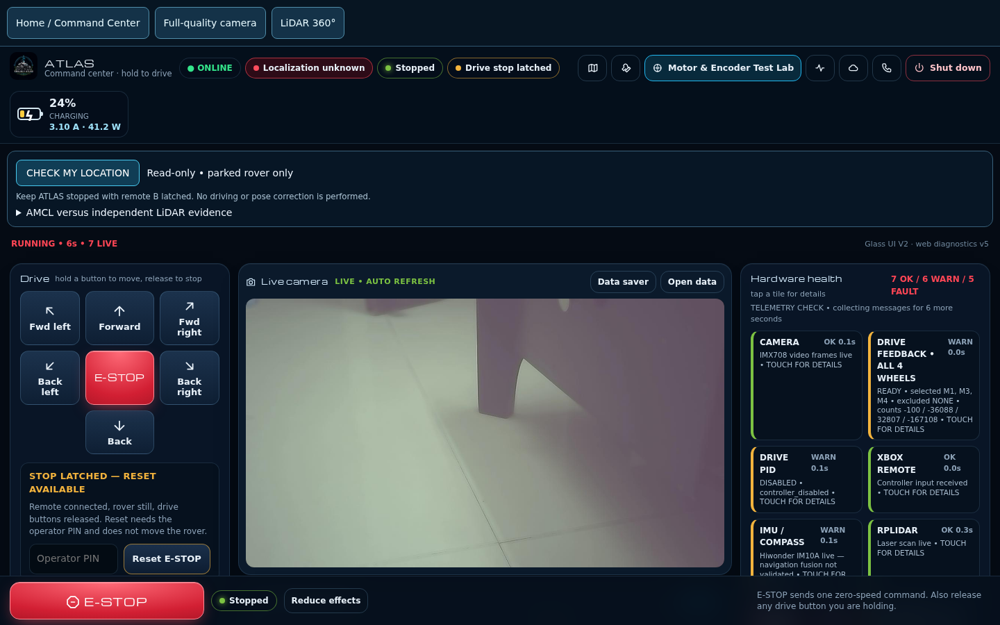
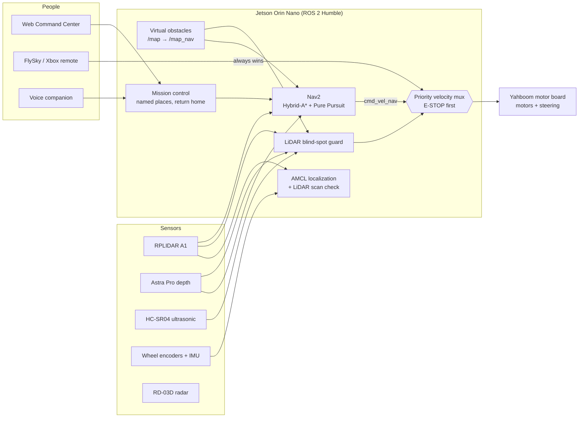
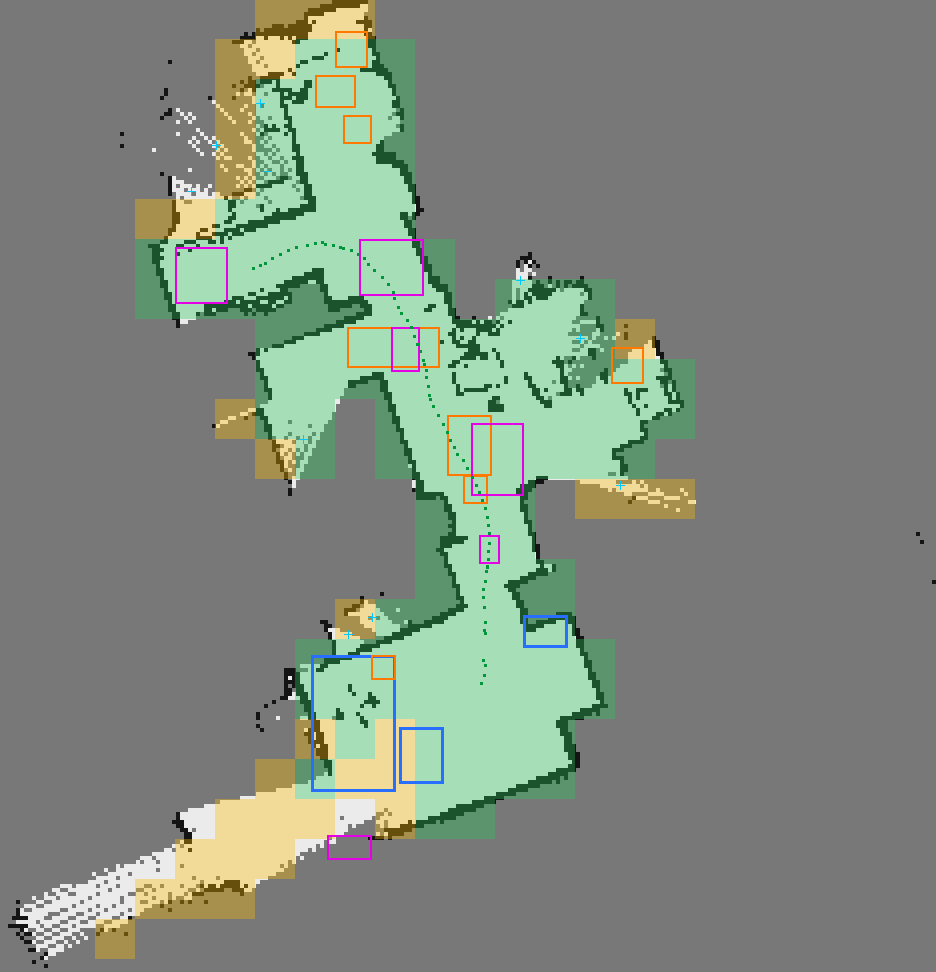
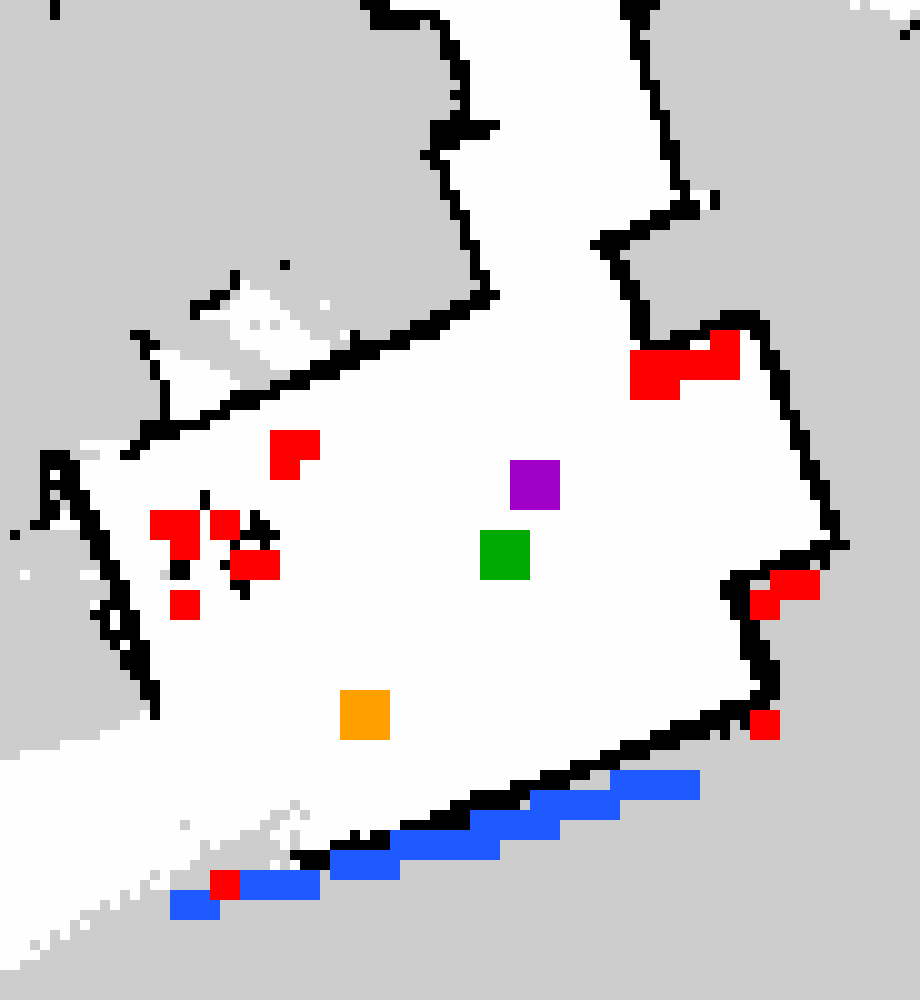

<div align="center">

# Project ATLAS

**An autonomous indoor service rover built from scratch on ROS 2 Humble and an NVIDIA Jetson Orin Nano**


[](https://github.com/Dhruv0747/ATLAS/actions/workflows/offline-tests.yml)

*Created by **Dhruv Kaushik***

</div>

<p align="center">
  
  <br><em>The ATLAS Command Center: live camera, drive controls, E-STOP, battery and hardware health in one page.</em>
</p>

---

## What is ATLAS?

ATLAS is a four-wheel-drive, four-wheel-steering rover that maps a home with LiDAR, knows where it is on that map,
and drives itself between named places ("Dhruv Room", "Hall") under supervision. Everything runs on the robot:
navigation, safety, the web dashboard, the voice assistant and the AI vision. The cloud is never in the control loop.

The project is built **safety first**. A hardware remote stop always wins, autonomy is off until the operator arms it,
and every change is tested on recorded drives before it reaches the robot. This repository is both the source code
and the full engineering record: every test, failure and fix is written down.

## Highlights

| | |
|---|---|
| 🗺️ **Mapping and localization** | LiDAR SLAM builds the home map; AMCL plus a LiDAR scan check confirm the robot's position before any drive. |
| 🧭 **Autonomous navigation** | Nav2 with a car-like (Reeds-Shepp) Hybrid-A* planner and Regulated Pure Pursuit, tuned for a 4-wheel-steering chassis. |
| 🛑 **Layered safety** | Remote E-STOP, priority velocity mux, LiDAR blind-spot guard, ultrasonic front/rear stop, encoder health checks, abort button. |
| 👁️ **3D vision** | Orbbec Astra Pro depth camera adds obstacles the LiDAR cannot see (dark or low objects) to the local costmap. |
| 🧱 **Virtual obstacles** | Objects invisible to the LiDAR (black sofa, glass table) are drawn once as polygons and respected by both Nav2 and the safety guard. |
| 🖥️ **Web Command Center** | Phone- and tablet-friendly dashboard: drive, map, named places, live camera, LiDAR view, battery time-left, readiness checklist. |
| 🗣️ **Voice companion** | Bilingual (Hindi/English) spoken status and commands on an ESP32-S3 voice interface. |
| 🔋 **Battery intelligence** | Daly BMS telemetry with phone-style "time left" and "time to full" estimates. |

## Project status

ATLAS follows a staged master plan. A stage is marked **PASS** only with recorded physical evidence.

| Stage | Goal | Status |
|---|---|---|
| 1 | Bounded 20 cm straight ground run | ✅ **PASS** (3-encoder mode, 12/12 runs, 2026-11-14) |
| 2 | Gentle left/right turn sequence | 🟡 Exercised in drives; formal evidence still to record |
| 3 | Supervised autonomous **Dhruv Room → Hall → Dhruv Room** round trip with safe-stop and return-home evidence | 🟠 **In progress** |
| 4+ | Wheel PID, visual odometry, semantic navigation, human-aware navigation | ⏳ Planned, only after Stage 3 |

**Stage 3 so far**

- ✅ Rover drives itself from Dhruv Room to the hall door; safe stop measured at **0.14 s / 6 mm**.
- ✅ Room-to-room goals inside Dhruv Room succeed.
- ✅ Hall furniture the LiDAR cannot see is now mapped as virtual obstacles (replay: hall stops ~100 % → ~20 %).
- ✅ Planner and goal tolerance retuned for the car-like chassis (fewer back-and-forth manoeuvres).
- 🔧 **Main blocker:** the dark hall door frame returns no LiDAR echo, so the safety guard stops the rover in the doorway
  (~96 % of doorway scans). Fix in progress: matte tape on the frame and two new side ultrasonic sensors.
- 🔧 Encoder consensus warnings occasionally pause autonomy.

Live, dated details: [current blockers log](docs/audits/ATLAS_CURRENT_BLOCKERS.md) · Full plan and history: [status and roadmap](docs/STATUS.md)

## Hardware

<table>
<tr><td>

| Part | Model |
|---|---|
| Chassis | [AM Robotics ROVER 4WDXL60R](https://www.amrobotics.in/products/rover-4wdxl60r-3-in-1-do-it-yourself-chassis-kit), 4WD + 4-wheel steering |
| Computer | NVIDIA Jetson Orin Nano Super 8 GB, NVMe |
| Motor controller | Yahboom ROS Driver Board V3.0 |
| Drive | 4 × 12 V 60 RPM geared DC motors with encoders, 125 × 60 mm wheels |
| Steering | 2 × 40 kg·cm servos (front and rear axle) |
| LiDAR | Slamtec RPLIDAR A1 (360°) |
| Depth camera | Orbbec Astra Pro |
| Camera | Raspberry Pi Camera Module 3 (IMX708) on pan/tilt |
| IMU | Yahboom board IMU + Hiwonder IM10A |
| Ultrasonic | HC-SR04, front and rear (side pair being added) |
| Radar | Ai-Thinker RD-03D (people detection) |
| Sensor hub | Arduino UNO R4 WiFi |
| Battery | 4S LiFePO4 (32140 cells), 15 Ah, Daly smart BMS |
| Remote | FlySky transmitter + Xbox controller |
| Voice | ESP32-S3 voice interface |

</td></tr>
</table>

**Chassis facts:** 1 mm powder-coated sheet metal, 5 kg payload, motors 1:168.75 gearbox, 2.4 kg·cm rated /
10.4 kg·cm stall torque. ATLAS footprint is **0.50 × 0.36 m**; the LiDAR sits 18 cm above the ground.
Full commissioned list with wiring routes: [docs/CURRENT_HARDWARE.md](docs/CURRENT_HARDWARE.md).

<!-- Owner photos go in docs/assets/photos/ (see the README there) and can be shown here. -->

## How it works



**Safety chain:** every movement command, from Nav2, the dashboard, voice or the remote, goes through one priority
mux. The remote stop overrides everything. Autonomy is *off* by default and must be armed by the operator. Nav2 commands
are blocked whenever a direction the rover will move into is not observed live by the LiDAR, depth camera, ultrasonic
or a known map wall, when encoders disagree, when localization is not confirmed, or when the depth camera stream is
stale. See [docs/SAFETY.md](docs/SAFETY.md).

## Quick start (operator)

1. Power on ATLAS and wait about 2 minutes for all services.
2. Open the dashboard from a phone or laptop on the same network or Tailscale: `http://<rover-ip>:8088/`
3. Keep the remote in hand. **B on the remote = stop.** The red **E-STOP** button on the dashboard does the same.
4. Check **Readiness** (`/v2/readiness.html`): it lists exactly what blocks autonomy and how to clear it.
5. Pick a named place on the map, arm autonomy, release the stop, press **Go**. **Abort mission** stops and cancels at once.

Every dashboard page and every command (start/stop services, logs, recording a drive, replay tools, tests, deploy)
is explained step by step in **[docs/COMMANDS.md](docs/COMMANDS.md)**.

## Gallery

<p align="center">
  
  
  <br><em>Left: a recorded drive replayed offline, showing where the depth camera found objects the LiDAR missed.
  Right: the hall furniture (red) and dark wallpaper wall (blue) that became virtual obstacles.</em>
</p>

## Repository layout

```text
ATLAS/
├── project_atlas/            Robot software (deployed to ~/project_atlas on the Jetson)
│   ├── scripts/              ROS 2 nodes: mux, mission control, dashboard server, guards, voice, battery…
│   ├── web/v2/               Web Command Center (HTML/JS/CSS)
│   ├── config/               Robot parameters (Nav2, EKF, virtual obstacles, battery…)
│   ├── launch/  systemd/     Launch files and user services that start everything at boot
│   ├── tests/                Unit tests; 127 robot-free modules (1,133 tests) run in GitHub CI on every push
│   └── tools/                Replay, diagnostics, recording and deploy tools
├── project_atlas_ws/src/     ROS 2 packages (bringup, localization launch, drivers)
├── firmware/                 Arduino UNO R4 sensor hub and ESP32 voice-speaker firmware
├── docs/                     All documentation (start at docs/README.md)
│   ├── audits/               Live blockers log, root-cause registry, investigations
│   ├── reports/              Dated engineering reports (stages, deployments, experiments)
│   ├── design/               Designs for upcoming features
│   ├── history/              Archived project log (the former README)
│   └── assets/               Maps, images and photos
├── monitoring/               Optional Prometheus + Grafana health monitoring (monitoring/atlas/README.md)
├── evidence/                 Screenshots and captures from tests
├── calibration/              Camera calibration guide and checkerboard
├── foxglove_extensions/      Foxglove Studio drive panel
└── .claude/skills/           Development-only workflow skills for AI coding agents (never deployed)
```

## Documentation

| Start here | |
|---|---|
| [docs/README.md](docs/README.md) | Map of all documentation, by topic |
| [docs/COMMANDS.md](docs/COMMANDS.md) | Every page and command, explained |
| [docs/STATUS.md](docs/STATUS.md) | What is done, what is left, roadmap |
| [docs/SAFETY.md](docs/SAFETY.md) | How ATLAS stays safe, and the rules for working on it |
| [docs/audits/ATLAS_CURRENT_BLOCKERS.md](docs/audits/ATLAS_CURRENT_BLOCKERS.md) | Dated log of every test, finding and fix |
| [AGENTS.md](AGENTS.md) | Rules for AI coding agents working on this repo |

## Engineering principles

- **Safety before features.** The remote stop overrides everything; nothing bypasses the safety gates.
- **Evidence over claims.** A unit test or a single good run is not a physical PASS. Failures are kept in the record.
- **Replay first.** Changes are tested against recorded drives (rosbags) before they touch the robot.
- **One change at a time.** Each deploy records what changed, why, how it was verified and how to roll it back.

## Author and citation

Project ATLAS is designed and built by **Dhruv Kaushik**. Please cite it using [CITATION.cff](CITATION.cff):

> Dhruv Kaushik, *Project ATLAS: ROS 2 Autonomous Service Rover*, 2026. https://github.com/Dhruv0747/ATLAS
