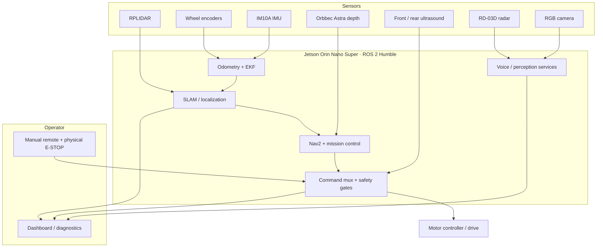

# Project ATLAS
### Autonomous Service Rover

**A safety-first, four-wheel indoor rover built with ROS 2, LiDAR SLAM, Nav2 and NVIDIA Jetson Orin Nano Super.**

[Engineering history](docs/PROJECT_HISTORY_2026-08-04_to_2026-11-16.md) · [Current status](docs/ENGINEERING_STATUS_2026-11-16.md) · [Stage 3 acceptance](docs/ATLAS_STAGE3_ACCEPTANCE_20261116.md)

---

> **Operational status:** ATLAS is an active engineering prototype. It has demonstrated manual operation, mapping, localization experiments, 3D point-cloud generation, guarded navigation goals and a measured safe-stop response. The full supervised Dhruv Room → Hall → Dhruv Room acceptance route had **not passed** as of 16 November 2026. Do not treat this repository as certification for unattended operation.

## What ATLAS is

ATLAS is a four-wheel indoor service-rover platform designed to map and navigate a home, travel between named places, stop safely when a route is unsafe, and eventually provide human-aware assistance. It combines deterministic ROS 2 control and safety layers with optional perception, voice and AI features.

The project began on **4 August 2026**. Its engineering history includes the initial navigation foundation audit, hardware commissioning, encoder and IMU investigations, mapping and localization corrections, Astra depth integration, RTAB-Map experiments, dashboard tooling and supervised autonomy trials.

## Current engineering snapshot — 16 November 2026

| Capability | Evidence-backed status |
|---|---|
| Jetson / Ubuntu / ROS 2 foundation | Commissioned baseline documented |
| Manual drive and command arbitration | Operational; retain physical E-STOP access |
| Encoder feedback | Degraded / qualification ongoing; M3 excluded in the latest recorded configuration and one critical sample remained in Stage 3 attempt 7 |
| EKF heading | Scoped correction applied; wheel velocity plus IM10A yaw performed substantially better in offline replay and a controlled turn |
| Full-drive localization | Not accepted; Hall pose/map mismatch and route-level corrections remain in evidence |
| 2D map | Remap 13 promoted after owner-approved parked review; old map retained in accepted backups |
| 3D mapping | RTAB-Map and coloured point-cloud prototypes exist; full calibrated whole-home 3D acceptance remains open |
| Nav2 single-goal operation | Demonstrated under guards; full room-to-room round trip not accepted |
| Safe stop | Stage 3 attempt 7: 0.14 s and 0.006 m measured stopping result |
| Human-aware navigation | Design document only; not implemented as an autonomy capability |
| Unattended autonomy | **Not approved** |

See the [full status and open gates](docs/ENGINEERING_STATUS_2026-11-16.md) and the [Stage 3 result](docs/ATLAS_STAGE3_ACCEPTANCE_20261116.md).

## System architecture

This is a conceptual data-flow view, not a complete wiring diagram or a statement that every perception feature is enabled in the live navigation path. The human-aware design keeps perception advisory: it may slow, stop, wait or add obstacle cost, but it must never grant motion or remove an existing safety veto.

## Hardware and software baseline

- **Compute:** NVIDIA Jetson Orin Nano Super 8 GB.
- **OS / middleware:** Ubuntu 22.04 and ROS 2 Humble.
- **Navigation:** Nav2, SLAM Toolbox, robot_localization EKF and mission-control nodes.
- **Range / perception:** RPLIDAR A1, Orbbec Astra Pro depth, RGB camera, RD-03D radar and ultrasonic sensors.
- **Drive feedback:** Yahboom motor controller and the currently qualified encoder subset. Encoder selection is configuration- and evidence-dependent.
- **Operator interface:** local web dashboard, diagnostics, manual remote and physical emergency stop.

Hardware revisions and sensor authority have changed during development. Consult the dated commissioning reports before assuming an older calibration, channel mapping or sensor is still authoritative.

## Repository guide

| Path | Purpose |
|---|---|
| project_atlas_ws/src/ | ROS 2 packages |
| project_atlas/scripts/ | Runtime nodes, diagnostics, tools and recovery |
| project_atlas/config/ | Robot and navigation configuration |
| project_atlas/maps/ | 2D map assets and accepted-map data |
| docs/ | Commissioning, investigations, deployment and acceptance evidence |
| monitoring/ | Read-only monitoring and recovery tooling |
| .github/workflows/ | GitHub Actions workflows |

## Engineering documents

- [Project history: 4 August – 16 November 2026](docs/PROJECT_HISTORY_2026-08-04_to_2026-11-16.md)
- [Current engineering status and acceptance gates](docs/ENGINEERING_STATUS_2026-11-16.md)
- [Stage 3 supervised round-trip result](docs/ATLAS_STAGE3_ACCEPTANCE_20261116.md)
- [EKF heading diagnosis and applied correction](docs/LOCALIZATION_HEADING_DIAGNOSIS_20261112.md)
- [RTAB-Map / 3D mapping step 1](docs/M3_3D_MAPPING_STEP1_20261112.md)
- [Human-aware navigation — design only](docs/ATLAS_HUMAN_AWARE_NAVIGATION_DESIGN_2026-11-16.md)
- [Detailed live blocker and investigation ledger](https://github.com/Dhruv0747/ATLAS/blob/claude/jetson-live-snapshot-20261106/docs/audits/ATLAS_CURRENT_BLOCKERS.md)
- [Development-branch changelog (latest detailed 15 November entries)](https://github.com/Dhruv0747/ATLAS/blob/claude/jetson-live-snapshot-20261106/CHANGELOG.md)
- [Original main-branch README preserved without edits](README_ENGINEERING_LOG_LEGACY_2026-10-31.md)

## Safety and development policy

1. Keep the physical emergency stop accessible during every ground test.
2. Treat missing, stale, invalid or ambiguous sensor data as unavailable; never silently convert it to a clear path.
3. Keep manual and autonomous command sources arbitrated through the existing command mux.
4. Run offline replay and focused regression tests before requesting a live change.
5. Deploy one bounded change at a time, with owner approval, backups, hashes, post-checks and a rollback path.
6. Distinguish code present, offline-tested, deployed, live-observed and physically accepted. They are not interchangeable.
7. Do not promote a successful parked test into a moving-navigation PASS.
8. Do not enable unattended operation until the published acceptance gates pass repeatedly.

The repository's read-only Jetson health workflow is manually dispatched and runs on the configured self-hosted ARM64 runner. It is not a general hosted CI test suite and does not certify robot navigation.

## Development and attribution

Start with [AGENTS.md](AGENTS.md) and the relevant dated handover before changing a runtime component. The repository contains hardware-specific scripts; broad test discovery or importing arbitrary tools may have side effects. Run only focused, documented test commands for the component being changed.

Project ATLAS was created by **Dhruv Kaushik**. Citation metadata is provided in [CITATION.cff](CITATION.cff).

**License:** No open-source license is currently declared in the repository. Do not assume the code is licensed for reuse; add an explicit license only after the owner selects one.
