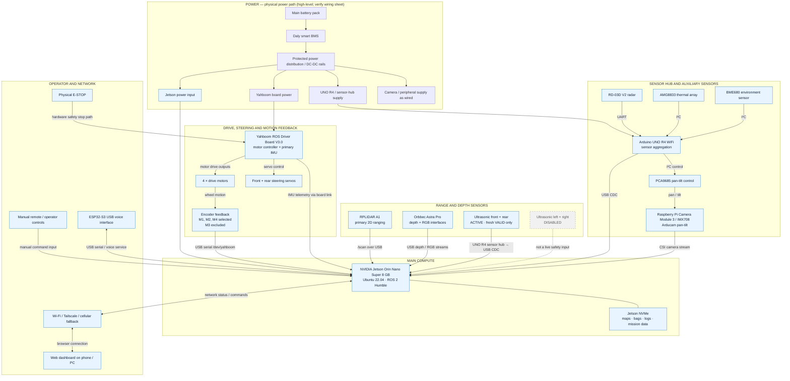
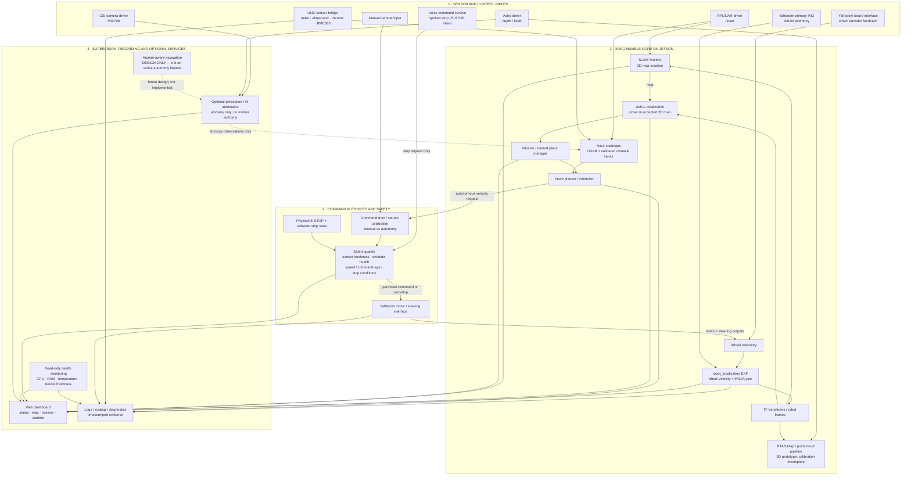
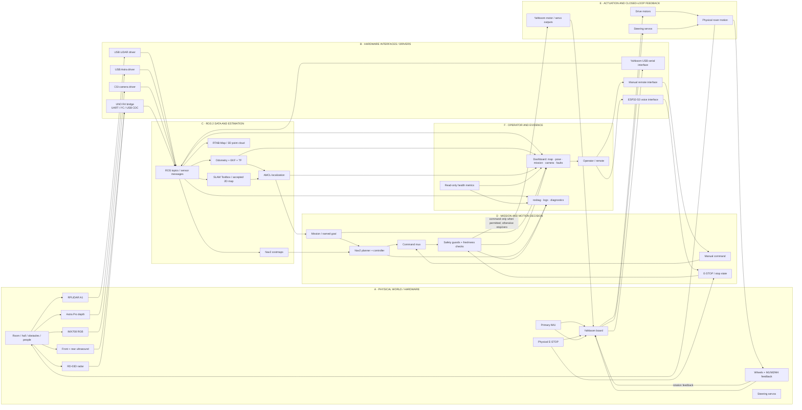

# ATLAS system architecture — hardware, software and combined data flow

**Evidence baseline:** repository documentation snapshot dated 16 November 2026, prepared on the documentation branch.
**Purpose:** explain how ATLAS hardware signals become ROS 2 data, how software turns those data into guarded motion commands, and how the operator supervises the rover.

> **Status key:** `ACTIVE / DOCUMENTED` means included in the recorded commissioned baseline; `DISABLED / EXCLUDED` means do not treat as a live input; `PLANNED` means not commissioned; `DESIGN ONLY` means not an implemented capability.
>
> These are system-level block/data-flow diagrams, not pin-to-pin wiring schematics. Exact connector pins, voltage rails, fuse values and cable routing must be taken from the current physical wiring record and verified on the rover. A diagram does not authorize energizing hardware or changing safety configuration.

## 1. Hardware block diagram

This view focuses on physical devices, buses and signal paths. Solid arrows represent documented data/control connections. The battery/power branch is intentionally shown at a high level because this document does not establish every rail and fuse connection.

### Hardware notes

- **Drive feedback:** M1, M2 and M4 are selected in the recorded configuration. M3 feedback is excluded; this does not mean the physical M3 motor is removed.
- **Ranging:** RPLIDAR A1 is the primary 2D ranging source. Only fresh, valid front/rear ultrasonic readings are eligible for the documented coverage logic. A short ultrasonic reading is not proof that the path beyond it is clear.
- **Depth / RGB:** Astra Pro connects over USB; the IMX708 camera uses CSI. The camera pan-tilt mechanism is controlled through the PCA9685/UNO path.
- **UNO sensor hub:** RD-03D radar arrives over UART; AMG8833 and BME680 use I²C; aggregated data reaches Jetson over USB CDC.
- **Operator safety:** keep the physical E-STOP accessible. Software stop and dashboard status do not replace the physical stop.
- **Not active:** left/right ultrasonic channels are disabled; legacy L76K GNSS is not verified active; CrowPanel display is planned, not commissioned. Retired hardware is listed in [HARDWARE_ARCHIVE.md](HARDWARE_ARCHIVE.md).

## 2. Software block diagram

This view follows the information from ROS 2 drivers through state estimation, mapping/localization, navigation and the final safety-controlled command path.

### Software notes

- **State estimation:** wheel odometry and the primary IMU feed the EKF. The recorded corrected configuration uses wheel velocity with IM10A yaw; the heading correction is not proof of full-route position accuracy.
- **Mapping and localization:** SLAM Toolbox creates/updates the 2D map; AMCL localizes against the selected map. RTAB-Map produces 3D point-cloud prototypes, but whole-home calibrated 3D acceptance remains open.
- **Navigation:** the mission manager selects a named place; Nav2 plans and controls a path using localization and costmaps.
- **Safety authority:** manual and autonomous requests pass through command arbitration and safety guards before reaching the motor interface. The E-STOP remains an independent physical safety mechanism.
- **Voice:** voice may request a stop; it must not bypass the safety guards or independently grant motion.
- **AI / human-aware perception:** optional perception can provide advisory observations only. The human-aware navigation document is a design, not an implemented autonomy capability.
- **Monitoring:** health monitoring is read-only. Missing or stale sensor values must be shown as unavailable/stale, never silently converted to zero or clear.

## 3. Combined hardware + software data-flow diagram

This is the end-to-end view: **physical sensor → interface/driver → ROS data → state/map/planning → safety arbitration → actuator → feedback**, with the operator and monitoring paths alongside it.

## 4. Read the system in 6 simple steps

1. **Sense:** LiDAR, depth/RGB, IMU, encoders, radar and enabled front/rear ultrasound observe the rover and its surroundings.
2. **Transport:** each device reaches Jetson through its documented interface — USB, CSI, UART/I²C through UNO R4, or the Yahboom serial link.
3. **Understand position:** ROS 2 drivers publish data; odometry + EKF + TF estimate motion; SLAM builds the 2D map and AMCL estimates the rover's pose on that map.
4. **Plan:** the mission manager requests a named destination; Nav2 plans a path using localization and costmaps. RTAB-Map is the separate 3D mapping prototype.
5. **Authorize motion:** manual/autonomous requests are arbitrated; safety guards check freshness and fault conditions; E-STOP can stop motion. Only then does a command reach the motor/steering interface.
6. **Close the loop:** wheel feedback and sensor data return to ROS 2; dashboard, logs and read-only health monitoring let the operator inspect what happened.

## 5. Current limitations shown by the diagrams

- The Stage-3 supervised Dhruv Room → Hall → Dhruv Room route had **not passed** as of 16 November 2026. Safe-stop measurement passed, but the full round trip failed.
- Encoder qualification remains degraded; M3 feedback is excluded and one CRITICAL encoder sample was recorded during the failed Stage-3 attempt.
- Full-drive localization and Hall-door sensor coverage still need repeatable validation.
- Full-home calibrated 3D mapping is not complete.
- Human-aware navigation is design-only.
- Unattended autonomy is **NOT APPROVED**.

## 6. Related engineering records

- [Current commissioned hardware](CURRENT_HARDWARE.md)
- [Engineering status and open acceptance gates](ENGINEERING_STATUS_2026-11-16.md)
- [Hardware archive and disabled/retired items](HARDWARE_ARCHIVE.md)
- [Stage-3 acceptance result](ATLAS_STAGE3_ACCEPTANCE_20261116.md)
- [Human-aware navigation — design only](ATLAS_HUMAN_AWARE_NAVIGATION_DESIGN_2026-11-16.md)
